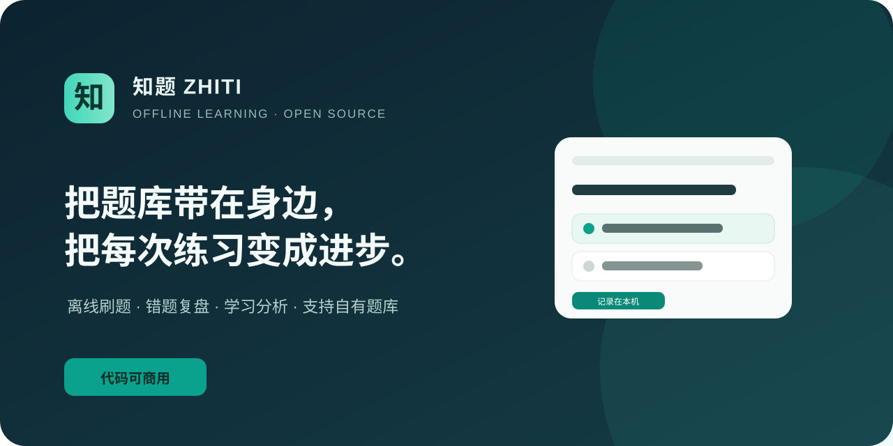
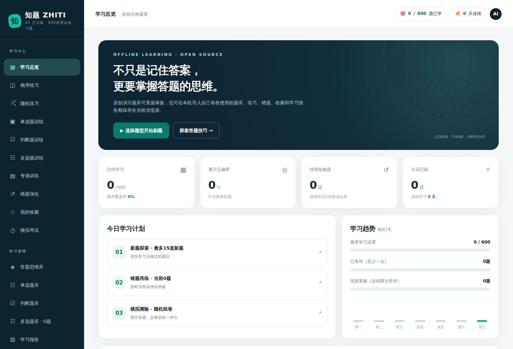
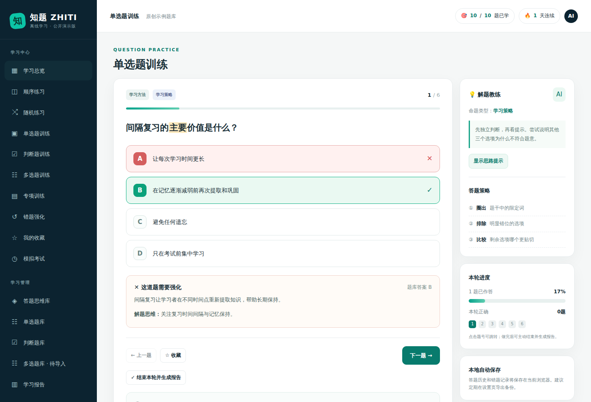
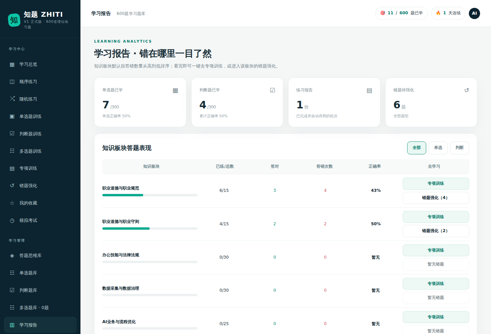
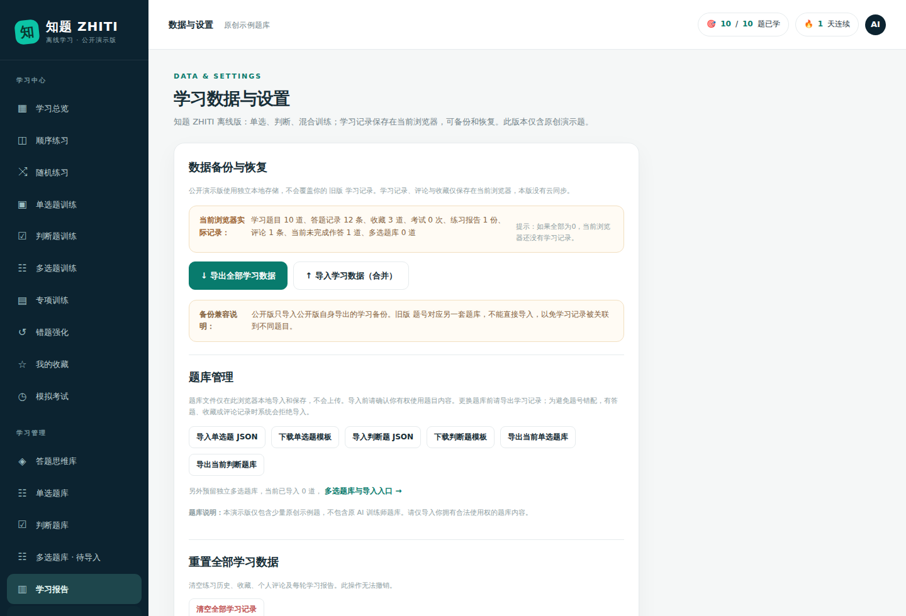
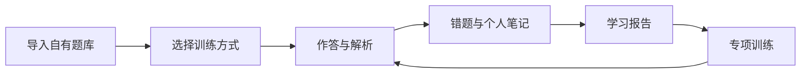

<div align="center">



# 知题 ZHITI

### 开源、离线优先的刷题与学习分析系统

**把题库换成你的，它就是你的考试学习站。**

[在线体验（启用 Pages 后）](https://jin-shanghai.github.io/zhiti-learning/) · [30 秒开始](#30-秒开始) · [功能一览](#你会得到什么) · [题库格式](docs/question-bank-format.md) · [English](README.en.md)

[](LICENSE)


</div>

## 这是什么

知题 ZHITI 是一个可以直接在浏览器运行的开源学习工具。它把普通题库变成一套完整的训练流程：练习、解析、错题强化、收藏、个人笔记、模拟考试和学习报告。

它适用于 **人工智能训练师（AI 训练师）备考**、职业资格考试、企业内训、学校课程和个人知识库。无需注册账号、无需安装数据库、无需把答题记录上传到服务器；一个 `index.html` 就能运行。

> 知题开源的是学习系统，不是未经授权的考试题库。公开版本只含少量原创示例题；你可以导入自己有权使用的单选、判断和多选题库。

## 为什么做知题

很多学习者手里已经有合法的教材或题库，却仍在用文档反复翻页：不知道自己错在哪里，也不知道下一轮应该练什么。

知题把“看答案”变成“训练闭环”：**作答 → 发现错因 → 按板块分析 → 错题强化 → 再次验证**。它不替你学习，而是让每一次练习都留下可执行的下一步。

## 看一眼

### 学习总览



### 做题、解析与解题思维



### 学习报告与薄弱板块



### 本地题库和学习数据管理



<p align="center"><sub>以上截图由原创示例题和模拟学习记录自动生成，不包含第三方考试题库内容。</sub></p>

## 你会得到什么

| 能力 | 说明 |
|---|---|
| **多题型训练** | 单选题、判断题、混合练习；多选题可通过 JSON 导入后独立训练 |
| **灵活练习** | 顺序、随机、专项、错题、收藏和模拟考试等多种模式 |
| **动态错题本** | 答错自动加入；连续两次答对后退出待强化列表 |
| **学习报告** | 保存每轮报告，累计分析各知识板块；默认按答错数量从高到低排序 |
| **一键去学习** | 从报告直接进入对应板块的专项训练或错题强化 |
| **解题思维库** | 从概念辨析、流程先后、场景匹配等角度训练判断方法 |
| **题库管理** | 导入、导出单选/判断题库；预留独立多选题库和模板 |
| **本地数据** | 答题、收藏、评论和题库保存在当前浏览器，可导出和恢复备份 |
| **离线与隐私** | 无账号、无后端、无分析脚本；下载后可断网使用 |
| **响应式界面** | 适配电脑与手机浏览器，适合个人学习和二次开发 |

## 30 秒开始

### 方法一：启用 Pages 后在线体验

当前仓库尚未启用 GitHub Pages，网址暂不可用。仓库所有者需先在 Settings → Pages 将 Source 设为 **GitHub Actions**；随后工作流会部署网页。启用后打开 [在线体验地址](https://jin-shanghai.github.io/zhiti-learning/)。

### 方法二：完全离线使用

1. 下载本仓库的 `index.html`。
2. 双击，用 Chrome、Edge 或 Safari 打开。
3. 直接体验原创示例题，或进入「数据与设置」导入自己的题库。

### 方法三：克隆仓库

```bash
git clone https://github.com/jin-shanghai/zhiti-learning.git
cd zhiti-learning
open index.html
```

不需要安装依赖。GitHub Pages 只是提供访问入口；答题数据仍保存在使用者自己的浏览器中。应用左下角的 **GitHub · 查看更新** 可打开本仓库。下载的离线文件不会自动更新；需要新版时重新下载 `index.html`，更新前先导出学习备份。

## 导入你自己的题库

进入「数据与设置」，选择单选题、判断题或多选题的 JSON 文件。支持题目数组，也支持 `{ "questions": [...] }` 包装格式。

- 完整字段与示例：[题库导入规范](docs/question-bank-format.md)
- 使用、备份与恢复：[使用说明](docs/usage.md)
- 多选题模板：可在应用内直接下载

**请只导入你有权使用的内容。** 题库只在本地浏览器处理，不会自动上传。清理浏览器数据可能删除进度，请保留原始题库并定期导出学习备份。

## 它是怎么工作的



所有核心功能都在浏览器中完成：题库负责提供内容，知题负责组织训练、记录表现并给出下一步入口。

## 适合谁

- 正在准备人工智能训练师三级、四级等职业技能考试的学习者
- 想把合法题库做成个人刷题网页的老师、培训机构或企业
- 需要离线学习、重视隐私、不希望注册账号的个人
- 想快速二次开发题库产品、学习系统或企业内训工具的开发者

## 品牌与项目身份

**知题 ZHITI** 是本项目的名称与视觉标识。欢迎依照 MIT 许可证使用代码、制作自己的学习产品，并保留原许可证和版权声明。发布修改版时，请标明修改者及与原项目的关系；若以独立产品对外运营，请使用自己的名称和标识，不要以“知题官方”名义宣传或暗示项目维护者背书。详细说明见 [NOTICE](NOTICE)。

## 隐私与边界

- 不含账号、云端数据库、统计分析脚本或外部题库接口。
- 答题记录、收藏、评论和导入题库只写入当前浏览器本地存储。
- 不同设备不会自动同步；请使用导出备份迁移学习记录。
- 学习备份包含已导入的多选题；单选和判断题库需另行导出并保管原始 JSON。
- 这是学习辅助工具，不保证题库答案或外部内容的权威性。

## 常见问题

### 这是人工智能训练师三级题库吗？

不是。本项目是适用于人工智能训练师备考的开源刷题和学习分析系统，公开仓库不附带未经授权的真实考试题库。你可以导入自己合法获得和有权使用的题目。

### 能导入自己的 AI 训练师题库吗？

可以。单选题、判断题和多选题都有独立入口与 JSON 格式说明，导入后可以使用错题强化、专项训练、模拟考试和学习报告。

### 我的题库和学习记录会上传吗？

不会。当前版本没有账号和服务器，题库与学习记录只保存在当前浏览器；请定期导出备份。

## 项目状态

当前版本为 **v0.1.0-rc1**，已经具备完整的离线训练、题库导入、错题强化和学习分析流程。自动测试会检查 JavaScript、题库脱敏、本地导入、文档和移动端断点。

## 参与项目

欢迎提交 Issue、改进建议和 Pull Request：

- [贡献说明](CONTRIBUTING.md)
- [安全说明](SECURITY.md)
- [题库与内容权利保护](CONTENT_RIGHTS.md)
- [版本记录](CHANGELOG.md)

如果你觉得知题有用，可以点一个 **Star**，让更多正在寻找“人工智能训练师刷题工具、AI 训练师学习系统、开源题库系统”的人看到它。

## 许可与版权

**本项目使用 MIT 开源许可证。**

- **程序代码：** [MIT License](LICENSE)，允许商业使用、修改和再分发。
- **名称与标识：** 可以为准确指明本项目来源而提及“知题 ZHITI”；使用修改版时不得暗示获得项目维护者授权或官方背书。详见 [NOTICE](NOTICE)。
- **用户导入题库：** 不属于本项目授权范围，权利和使用责任由导入者自行确认。

题库和内容权利的提交要求、投诉与移除流程见 [题库与内容权利保护](CONTENT_RIGHTS.md)。网上可下载的题目不等于允许放进开源仓库；收到投诉再删除也不能替代事先授权。

---

**搜索关键词：** 人工智能训练师 · AI 训练师 · 人工智能训练师三级 · AI Trainer · 刷题系统 · 题库系统 · 错题本 · 学习分析 · 离线学习 · 开源学习工具
